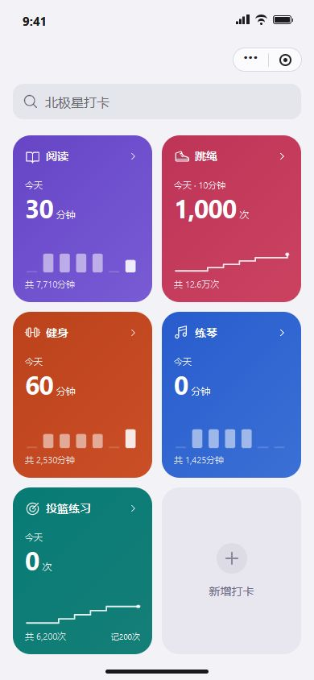
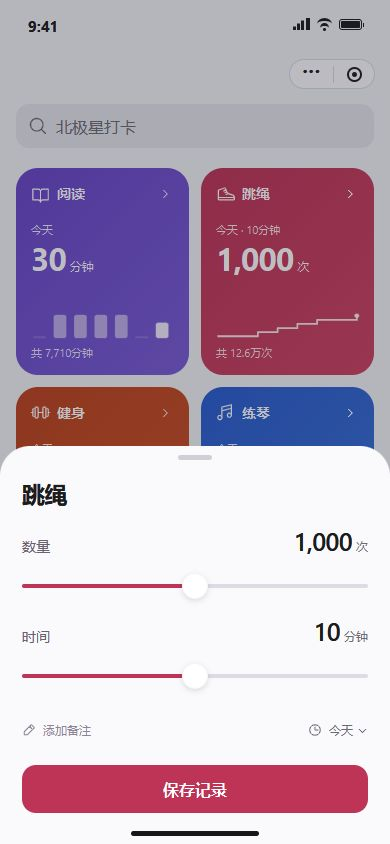
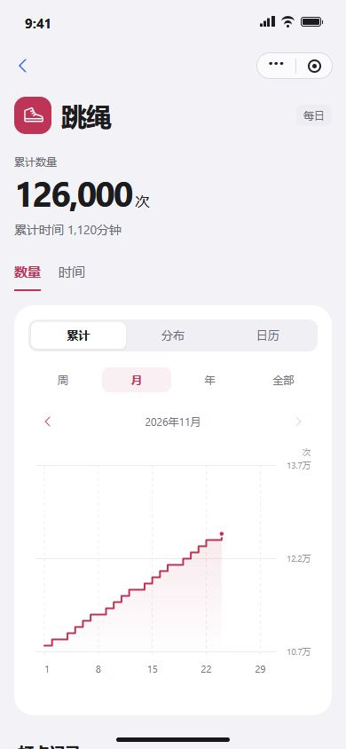
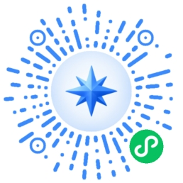

# 北极星打卡

**记下今天，看见日积月累。**

读了30分钟，跳了1000次。北极星打卡是一款专注「记录」与「统计」的微信小程序，用时间和数量，留下每一次投入。

## 把喜欢的事记下来

阅读、运动、练琴、写作……按自己的习惯创建打卡，选择喜欢的颜色与图标。首页一眼看到今天、本周或本月的投入，也能回看从开始到现在的积累。

## 时间、数量，一次记清楚

可以只记时间、只记数量，也可以一起记。拖动滑块或直接输入数值，添一句备注；忘记记录时，也能补记过去。开启快速打卡后，常用的量点一下就记好。

## 回头看看，已经走了多远

累计看长期积累，分布看每段时间的投入，日历看每天的节奏。时间与数量分别统计，按周、月、年或全部历史回看。

## 产品画面

  
  
  

*画面中的项目与数值为演示数据。*

## 微信扫码使用

从今天的一次投入开始。打开微信扫一扫下方小程序码，进入「北极星打卡」查看并使用；在手机上查看时，可保存图片后用微信识别。

