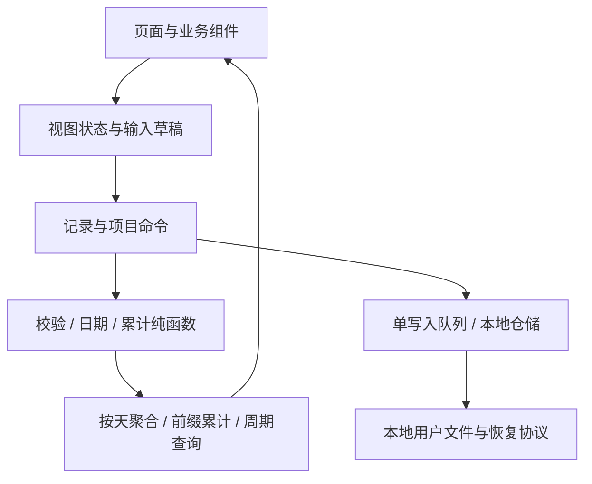

# 技术架构与本地数据设计 v1

更新日期：2026-11-24。状态：架构设计与技术决策。已创建原生微信小程序工程骨架与开发检查入口，尚未实现下述存储协议或通过真机测试。环境验证见 [框架搭建记录](框架搭建记录-20261124.md)。

## 1. 技术决策

| 事项 | 首版选择 | 原因和边界 |
|---|---|---|
| 客户端 | 原生微信小程序，TypeScript + WXML + WXSS | 当前仅微信，不引入跨端框架与额外运行层 |
| 渲染 | 首版WebView渲染器 | 卡片、原生slider与底部面板满足当前实现方向；优先成熟兼容性与Canvas调试。Skyline保留为实测后的迁移选项 |
| 组件 | 自定义轻量业务组件，复用原生输入/日期/滚动能力 | 避免为少量页面引入整套视觉风格不同的组件库 |
| 图表 | 原生Canvas 2D，自绘累计线与柱图 | 只需两种图形，一个详情主图，避免大型图表依赖 |
| 原始数据 | FileSystemManager，本地用户文件 | 普通KV单键1MB/总10MB，不适合作为不断增长的整库 |
| 少量偏好 | wx.setStorage / wx.getStorage | 仅可重建偏好，不作为记录的唯一依据，不做跨存储的原子事务假设 |
| 后端 | 无 | 无账号登录、云开发、远程接口、服务器运行费用 |
| 依赖 | 运行时尽量零第三方依赖；开发时TypeScript、官方类型和测试工具 | 开发初始化时核对兼容版本并锁定，不在文档虚构最新版本号 |

选择WebView不等于已经证明所有目标机型手感达标。先用原生slider提供连续跟手调节，避免逻辑层逐帧重绘滑块。若后续实机证据表明其不能满足交互预算，再用同一数据与交互契约评估Skyline，不能仅为使用已安装skill引入双渲染维护。

基础库以3.0及以上作为初始兼容目标；具体使用版本在建工程时锁定，并与官方工具、Canvas、page-container、文件系统能力核对。旧技能中版本和支持表存在历史差异，官方文档和实机结果优先。

## 2. 分层与页面



页面只需首页、项目详情、项目编辑。记录/历史编辑使用共享底部面板，优先用原生page-container处理遮罩和返回行为。次级本地数据说明不扩成个人中心。

业务组件：project-tile、record-sheet、metric-slider、practice-chart、record-list、project-form、undo-toast。组件接收已格式化的视图模型并发出明确动作，不直接操作文件或跨项目累计。

建议模块目录：pages、components、domain（模型/校验/日期/统计）、application（命令与查询）、infrastructure（本地文件/迁移/平台适配）、assets、tests。最终源码根在project.config.json中明确，与prototype目录分开。

## 3. 数据模型

### 3.1 Project

| 字段 | 语义与约束 |
|---|---|
| id | 不透明稳定标识，不用名称关联记录 |
| name | 非空，最多24字符 |
| colorId / iconId | 有限资源预设，校验允许值 |
| recordMode | duration / quantity / both |
| primaryMetric | durationSeconds / quantity，必须在当前启用范围内 |
| timeMin / timeMax | 非负安全整数，以timeUnit为单位，最大大于0且不小于最小 |
| timeUnit | 分 / 时 / 秒，默认分；存储量不随显示单位改变 |
| quantityMin / quantityMax | 非负安全整数，最大大于0且不小于最小 |
| quantityUnit / quantityUnitLocked | 默认次，1～4字符，首次保存数量记录后永久锁定 |
| defaultTime / defaultQuantity | 范围内正整数；修改范围时自动计算向下取整的中点，可手动覆盖 |
| directEntryEnabled | 默认false，开启需显式设置所有启用指标默认值 |
| createdAt / updatedAt / revision | 真实设备时间戳与乐观修订号 |

### 3.2 PracticeRecord

| 字段 | 语义与约束 |
|---|---|
| id / projectId | 稳定标识，项目须存在且未被删除 |
| occurredOn | 用户确认的YYYY-MM-DD，真实日历日期且不晚于当天 |
| localTime | HH:mm或null，不能用保存时刻补齐 |
| durationSeconds | 正安全整数秒或null，与timeUnit的显示选择分开 |
| quantity | 正安全整数或null，使用项目固定单位 |
| quantityUnit | 有数量时保存单位快照，否则null |
| note | 文本，最多500字符，非富文本 |
| createdAt / updatedAt / revision | 首次保存、最近修改与修订号 |

至少一项积累值有效。记录条数由有效记录数量得到，不设一个容易与练习量混淆的count字段。不把空项转成0，不合并相同数值的真实记录。

打卡类型在编辑器中是两个独立布尔选择，持久化时映射为duration/quantity/both；全未选只存在于草稿，保存前拒绝。关闭类型不清空其配置字段。范围默认值使用min + floor((max - min) / 2)，避免大整数相加溢出；改范围才重算，手动默认值、草稿恢复及类型切换保持稳定。

数量单位按项目固定，不跨项目累计；首次成功保存数量记录即置quantityUnitLocked，后续删除或撤销不解锁。写入校验记录单位快照与项目单位一致。范围收窄只约束之后修改的值，不追改旧记录；旧值未变时可以随其他字段一起保存。

时间使用整数秒、数量使用项目单位下的整数保存；小时格式化、大数简写只在视图层做。逐条值和累计结果都校验Number.isSafeInteger，不静默溢出。记录标识在第一次提交前生成并留在当前面板会话中，失败重试沿用同一标识；内部写入日志恢复不等于恢复未提交的用户输入。

### 3.3 面板输入、项目草稿、Undo与缓存

RecordSession区分新记录与编辑，保存recordId、projectId、字段值、发生日期及原修订号，仅存在于当前面板。关闭、遮罩或Esc后销毁，不持久化待续填输入。重开新记录使用项目默认值，编辑读取已保存记录；历史空项不补默认。保存失败保留当前面板输入以便重试，正式仓储内部日志仍负责已经开始的写入恢复。

新建项目配置另设单份NewProjectDraft，与当前打卡会话隔离，保留全部原始输入和配置，即使内容暂不合法也可保存草稿。取消直接返回并保留，再次新增恢复；只有显式创建并成功写入项目才清除。正式版随输入在本地保存，取消/退后台时补写；恢复不创建项目、不触发打卡。浏览器评审稿只在当前页面内存中演示，刷新仍重置。

首页搜索是视图状态，按项目名进行NFKC标准化、首尾去空白和大小写无关的包含匹配，不写入项目实体或聚合缓存。进入详情和取消新增保留查询，创建成功后清空查询。

Undo只针对新记录和单条删除，保存目标记录标识、必要原值、原保存时间及绝对expiresAt，约5秒。项目删除不提供撤销，也清理相关Undo与草稿。

按天汇总、项目总量、索引与前缀和是派生缓存，带sourceRevision；缓存与原始记录版本不一致就重建。缓存不是第二份权威数据。

聚合结果同时包含hasDurationData与hasQuantityData等数据存在标识。数值和可以为0，但界面需要据存在标识区分从未填写与真实已记录量，不仅依赖一个总和判断。

## 4. 本地文件方案

官方文档本次核对：普通KV单键最大1MB、合计10MB；加密KV还有额外体积开销。本地用户文件与缓存文件共享200MB额度。实际可写空间仍受设备和平台策略影响。

以一条包含真实字段的JSON记录序列化测量：6字备注约279字节，500字中文备注约1761字节。1万条约2.67MiB或16.80MiB，不含索引与恢复数据。该结果仅是样本字节测量，不是存储性能或容量保证。

因此原始记录放在用户文件目录，按项目与发生月份分片，每页目标不超过128KiB（按UTF-8字节计算），满页继续拆分。目录示意：

```text
USER_DATA_PATH/accumulation/v1/
  manifest-a.json
  manifest-b.json
  objects/projects/<project-id>/<revision>.json
  objects/records/<project-id>/<YYYY-MM>/<page-id>.json
  objects/summaries/<project-id>/<revision>.json
  drafts/new-project.json
  deleted-projects/<project-id>.json
```

文件名只由校验过的内部ID与日期生成，不接受项目名、备注或外部路径。仓储所有操作限定在自己的根目录，不能清理其他小程序文件。

普通KV只保存上次筛选项等小偏好。业务提交不同时依赖KV与文件系统共同成功，避免制造没有事务保证的跨存储写入。

## 5. 写入与中断恢复

SDK没有本方案所需的跨文件事务。采用应用级协议，不能把rename或单次回调直接描述成跨文件原子性。以下协议必须在编码后用故障注入验证。

1. 所有业务变更进入单写入队列，校验命令、原修订号和项目删除标记。
2. 分配稳定recordId/operationId，冻结本次待保存内容；反复点击或重试不生成新的记录身份。
3. 将受影响页写成新版本文件，不原地覆盖仍被当前清单引用的记录页；保存格式版本、字节长度与校验值。
4. 回读校验新页与新的项目索引/派生摘要。失败时不发布新清单，不提示成功。
5. 写入非当前清单槽位，包含更高generation、新文件引用与清单校验值，回读并验证新引用。
6. 清单验证成功为普通命令的提交点，之后才更新视图并提示成功。启动时选择结构、校验与必要引用有效的最高generation。
7. 崩溃留下的未引用页是候选孤儿，只有确认不被两个有效清单、在途写入及有效撤销引用时才可回收。

校验值用于发现意外损坏，不声称它提供加密或抗篡改认证。若新清单不可读但旧版本可读，可进入明确提示的恢复流程；不能静默清空数据，也不能假称恢复结果就是最后一次成功状态。

项目删除额外先写并回读不可复用projectId的删除标记，再整理清单与文件。删除标记一经确认，读取与写入均拒绝该项目，即使回读旧清单也不复活项目。整理失败可幂等续做，不能在删除已经生效后谎报项目仍可用；未确认删除标记写成前不得提示已删除。

只保留仍被有效清单引用的版本及必要撤销数据，后台回收孤儿。目录接近软容量线（初始建议120MB）先清理可重建缓存与无引用版本，保留写入余量；仍不足时明确拒绝新写入、保留原记录，不自动删除练习历史。

两个清单都损坏、原页损坏或系统清除用户文件时，保护剩余文件并停止对受影响数据写入，不能凭空还原没有备份的内容。内部恢复只保护正常写入中断，不等于换机备份或硬件损坏无损保证。

## 6. 命令契约

| 命令 | 关键约束与返回 |
|---|---|
| CreateProject / UpdateProject | 全量校验配置；修改使用expectedRevision；不产生记录 |
| AddRecord | 稳定recordId，重试幂等；至少启用一项，所有启用指标均有效；返回已提交revision与recordId |
| UpdateRecord | 旧字段还原，缺失不补默认；检查记录修订号；保持createdAt |
| DeleteRecord | 移出有效统计，生成带绝对期限的撤销信息 |
| Undo | 恢复同一标识与createdAt，不创造副本；检查项目还存在、未超期 |
| DeleteProject | 明确确认后写删除标记、清理草稿/撤销及索引；迟到命令不得复活 |
| SaveNewProjectDraft | 仅保存新增项目的原始配置，不产生项目或记录；打卡会话关闭即丢弃，不持久化续填 |

输入错误、冲突、项目不存在、空间不足、写入失败、数据损坏、未知新版本格式需要区分。界面提供用户能理解的提示，完整技术错误留在本机调试信息，不上传备注或个人记录。

## 7. 累计与日期算法

先校验原始记录，再按occurredOn构建每日增量，分别维护durationSeconds与quantity。对日期排序后计算前缀和。

- 周/月/年分布只取所选周期内增量。
- 累计曲线起点包含所选周期之前的前缀基数，历史点不能包含之后记录。
- 日视图按已知时间点排序；当日存在未知时间点时用稳定次序并明确未知，不伪造实际先后。
- 修改日期相当于从原日减去原量、向新日加入新量；最早受影响日期之后前缀失效并重建。
- 删除与撤销使用同一套增量规则，不能只加减首页数字。
- 时间点为空不采用createdAt补齐；本地日历值不经UTC重新归日，周从周一开始。
- 当前周期未来日期不绘制增长，未来发生日期不能进入记录。
- 不跨项目合并数量，不计算能力分数，不用练习条数替代动作重复量。

实现目标：首次读取按项目局部加载，按天聚合O(N)，日期排序O(D log D)，周期图按桶查询，避免为每根柱反复扫描全部记录。原型中的简单模拟统计不作为生产算法直接复制。

## 8. 滑动控件与图表实现

浏览器使用原生range，正式微信优先评估原生slider，不绘制刻度。数量始终按1递增，项目不保存quantityStep字段；时间滑动以所选单位的整数调节。浏览器拖动保持连续位置，只把显示和草稿量转换为有效整数，松手后对齐，避免每次input写回整数导致滑块跳动。

范围端点、默认值与精确值的坐标均由真实数值差计算。只更新当前数值和滑轨填充，不因高频输入重建面板；辅助功能和方向键按1增减，Home/End到达边界。合法精确时间及未改动历史记录仍保存原秒数。

图表在详情使用一个Canvas 2D节点，尺寸按CSS布局乘devicePixelRatio设置，绘图前处理缩放与清空。重绘只发生在数据、指标、范围、布局变化时，不启动永久计时器。

坐标、分桶和触碰命中是独立纯函数。可用折线/阶梯线与柱图统一渲染接口，避免引入业务无关的图表库。数据量大时先聚合再绘制，记录列表预览最多5条，查看全部时读取项目全历史分页，首批及后续每批20条；后续页仅追加列表节点，不重绘图表或整页、不改变已有滚动位置。使用页面滚动触发加载，保留手动加载按钮；按occurredOn/createdAt/id稳定倒序分页，避免重复或跳行。正式仓储应以稳定游标读取本地分片，原型仅演示内存数组切片。切换周期/项目或收起时重置分页，销毁旧观察器，迟到回调不得追加至新项目。

## 9. 测试与版本

领域层测试：缺失、整数边界、统计基数、补记、编辑、删除撤销、周一/跨年/闰日、时区不漂移、模式变化。

仓储测试：每一步写入失败、清单半写、回调丢失后重试、应用中断、缓存失效、空间不足、旧格式迁移、未知新格式拒写、项目删除标记与迟到命令。

真机测试：iPhone和Android的滑块跟手、纵横手势冲突、边界吸附、整行日期/时间选择器、原生键盘、page-container返回、Canvas层级、后台恢复、文字放大与减少动效。

schemaVersion按格式演进，读取旧格式先保留原文件再迁移；版本过新时拒绝写入并提示更新，不重置。不在读取页面时顺手改写历史业务字段。

## 10. 本次核对的官方来源

核对日期：2026-11-24，均成功读取到官方正文。容量是文档上限，运行时仍处理实际失败。

- [wx.setStorage](https://developers.weixin.qq.com/miniprogram/dev/api/storage/wx.setStorage.html)：单键1MB、总10MB；正文说明主动删除或空间清理会影响可用性。
- [wx.getStorageInfo](https://developers.weixin.qq.com/miniprogram/dev/api/storage/wx.getStorageInfo.html)：currentSize/limitSize单位KB，只反映KV，不能拿它当文件系统剩余空间。
- [文件系统](https://developers.weixin.qq.com/miniprogram/dev/framework/ability/file-system.html)：本地用户文件与本地缓存文件共享200MB，可用自定义目录和文件名。
- [Skyline介绍](https://developers.weixin.qq.com/miniprogram/dev/framework/runtime/skyline/introduction.html)：解释WebView双线程模型与新增渲染管线。本方案不照抄旧技能中不一致的版本/性能数字。
